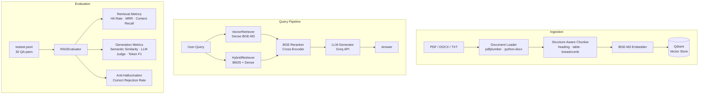

# VietRAG

> **A Production-Grade Vietnamese RAG Engine with Hybrid Search, Advanced Chunking & Anti-Hallucination Pipeline**

[](https://python.org)
[](https://fastapi.tiangolo.com)
[](https://qdrant.tech)
[](LICENSE)

VietRAG is a full-stack Retrieval-Augmented Generation (RAG) system optimized for Vietnamese academic and technical documents. It combines hybrid dense–sparse retrieval, a cross-encoder reranker, structure-aware chunking, and a multi-metric evaluation framework to deliver accurate, grounded answers with zero hallucination on out-of-scope queries.

---

## Architecture



---

## Key Features

| Feature                         | Details                                                                            |
| ------------------------------- | ---------------------------------------------------------------------------------- |
| 🔍 **Hybrid Search**            | Dense retrieval (BGE-M3 1024-dim) + Sparse BM25 fused via Reciprocal Rank Fusion   |
| ⚡ **BGE Reranker**             | `BAAI/bge-reranker-v2-m3` Cross-Encoder for precision re-scoring                   |
| 🧩 **Structure-Aware Chunking** | Heading detection, table preservation, chapter/section breadcrumb metadata         |
| 🛡️ **Anti-Hallucination**       | Explicit refusal on unanswerable queries — 100% correct rejection on benchmark     |
| 🧑‍⚖️ **LLM-as-a-Judge**           | Groq-powered answer relevancy scoring (0–1) via `eval_prompt.yaml`                 |
| 📐 **Semantic Similarity**      | Cosine similarity between generated answer and ground truth embeddings             |
| 🔀 **Dual Prompt Mode**         | `eval_prompt.yaml` for direct answers · `qa_prompt.yaml` for detailed explanations |
| 🌐 **REST API**                 | FastAPI backend with streaming support                                             |
| 🖥️ **Web UI**                   | Streamlit chat interface                                                           |
| 📊 **Full Evaluation Suite**    | Retrieval + Generation + Anti-Hallucination metrics in a single CLI run            |

---

## Benchmark Results

Evaluated on a 30-question testset (24 answerable + 6 unanswerable) from Vietnamese academic PDF/DOCX documents.  
Configuration: **Hybrid Search + BGE Reranker + `eval_prompt.yaml`**

### Retrieval Performance

| Metric                     | Score  |
| -------------------------- | ------ |
| Hit Rate @ 1               | 67.5% |
| Hit Rate @ 3               | 92.5% |
| Hit Rate @ 5               | 95.0% |
| MRR (Mean Reciprocal Rank) | 79.375% |
| Context Recall             | 90.625% |

### Generation Performance

| Metric                       | Score  |
| ---------------------------- | ------ |
| Semantic Similarity (Cosine) | 72.50% |
| Answer Relevancy (LLM Judge) | 83.40% |
| Token F1-Score               | 41.44% |
| Token Precision              | 34.38% |
| Token Recall                 | 65.34% |


### Anti-Hallucination

| Metric                 | Score       |
| ---------------------- | ----------- |
| Correct Rejection Rate | **100.00%** |
| Hallucination Rate     | 0.00%       |

### Ablation: Effect of Reranking & Hybrid Search

| Configuration          | Hit@1      | Hit@3      | MRR        | Context Recall |
| ---------------------- | ---------- | ---------- | ---------- | -------------- |
| Dense Only (no rerank) | 67.5%     | 92.5%     | 79.375%     | 90.625%         |
| Hybrid + Rerank ✅     | **80.00%** | **95.00%** | **88.75%** | **99.38%**     |
| Δ Improvement          | +13.5%     | +0.25%     | +9.375%     | +9.38.42%        |

---

## Project Structure

```
vietnamese-rag/
├── api/                        # FastAPI REST API
│   └── main.py
├── app/                        # Streamlit web UI
│   └── app.py
├── configs/
│   ├── config.yaml             # Main configuration
│   └── prompts/
│       ├── eval_prompt.yaml    # Direct-answer prompt (evaluation)
│       └── qa_prompt.yaml      # Detailed-answer prompt (production)
├── data/
│   ├── raw/                    # Source documents (PDF, DOCX, TXT)
│   ├── processed/              # Chunked documents cache
│   └── eval/
│       └── testset.jsonl       # 30-sample benchmark dataset
├── scripts/
│   ├── run_ingest.py           # Ingestion CLI
│   ├── run_query.py            # Query CLI
│   └── run_eval.py             # Evaluation CLI
├── src/
│   ├── config.py               # Pydantic config models
│   ├── evaluation/             # Evaluation framework
│   │   ├── dataset.py          #   EvaluationDataset, EvalSample
│   │   ├── metrics.py          #   Token F1, Semantic Similarity, Retrieval metrics
│   │   ├── judge.py            #   LLM-as-a-Judge (Groq)
│   │   └── evaluator.py        #   RAGEvaluator orchestrator
│   ├── ingestion/
│   │   ├── loaders/            #   PDF (pdfplumber), DOCX, TXT loaders
│   │   ├── chunkers/           #   RecursiveCharacterChunker
│   │   └── indexer.py          #   QdrantIndexer
│   ├── pipeline/
│   │   └── rag_pipeline.py     # End-to-end RAG pipeline
│   ├── retrieval/              # VectorRetriever, HybridRetriever
│   ├── reranker/               # BGEReranker (Cross-Encoder)
│   ├── generator/              # LLM Generator (Groq / Ollama)
│   ├── storage/                # Storage utilities
│   └── monitoring/             # Telemetry
├── notebooks/
│   └── 06_evaluation.ipynb     # Interactive evaluation notebook
├── docker-compose.yml          # Qdrant service
├── requirements.txt
├── .env.example
└── README.md
```

---

## Prerequisites

- **Python** 3.13
- **Docker** (for Qdrant vector database)
- **Groq API Key** — free tier available at [console.groq.com](https://console.groq.com)
- **Tesseract OCR** _(optional)_ — for scanned PDF support

---

## Setup & Installation

```bash
# 1. Clone the repository
git clone https://github.com/<your-username>/vietnamese-rag.git
cd vietnamese-rag

# 2. Create and activate virtual environment
python -m venv .venv

# Windows
.\.venv\Scripts\activate
# Linux / macOS
source .venv/bin/activate

# 3. Install dependencies
pip install -r requirements.txt

# 4. Configure environment variables
cp .env.example .env
# Open .env and fill in: GROQ_API_KEY, QDRANT_HOST, etc.

# 5. Start Qdrant vector database
docker compose up -d
```

---

## Usage

### 1. Ingest Documents

Place your PDF/DOCX/TXT files in `data/raw/`, then run:

```bash
python scripts/run_ingest.py --source data/raw/
```

### 2. Query from CLI

```bash
# Basic query
python scripts/run_query.py --query "Câu hỏi của bạn ở đây"

# With streaming output
python scripts/run_query.py --query "Câu hỏi của bạn" --stream

# Retrieve only (no generation)
python scripts/run_query.py --query "Câu hỏi của bạn" --retrieve-only
```

### 3. Start the API Server

```bash
uvicorn api.main:app --reload --host 0.0.0.0 --port 8000
```

API docs available at `http://localhost:8000/docs`.

### 4. Launch the Web UI

```bash
streamlit run app/app.py
```

---

## Evaluation

```bash
# Full benchmark (Hybrid + Rerank + LLM Judge)
python scripts/run_eval.py

# Quick test on 5 samples, skip LLM Judge
python scripts/run_eval.py --limit 5 --no-judge

# Baseline: dense-only, no rerank
python scripts/run_eval.py --no-rerank --no-hybrid --output data/eval/results_baseline.json

# Use detailed QA prompt instead of eval prompt
python scripts/run_eval.py --use-qa-prompt

# Disable hybrid search only
python scripts/run_eval.py --no-hybrid
```

Results are saved to `data/eval/` as JSON (excluded from version control via `.gitignore`).

---

## Configuration

Edit `configs/config.yaml` to tune the pipeline:

```yaml
retrieval:
  top_k: 5 # Number of chunks to retrieve
  use_hybrid: true # Enable BM25 + Dense fusion
  use_rerank: true # Enable BGE cross-encoder reranker

embedding:
  model: BAAI/bge-m3 # Embedding model

reranker:
  model: BAAI/bge-reranker-v2-m3

llm:
  provider: groq
  model: openai/gpt-oss-120b

chunking:
  chunk_size: 512
  chunk_overlap: 64
```

---

## Environment Variables

Create a `.env` file at the project root (see `.env.example`):

| Variable            | Required    | Description                                               |
| ------------------- | ----------- | --------------------------------------------------------- |
| `GROQ_API_KEY`      | ✅ Yes      | Groq API key for LLM generation                           |
| `EVAL_GROQ_API_KEY` | ⬜ Optional | Separate key for LLM Judge (falls back to `GROQ_API_KEY`) |
| `QDRANT_HOST`       | ✅ Yes      | Qdrant server host (default: `localhost`)                 |
| `QDRANT_PORT`       | ✅ Yes      | Qdrant server port (default: `6333`)                      |
| `QDRANT_API_KEY`    | ⬜ Optional | Qdrant API key (for Qdrant Cloud)                         |
| `COHERE_API_KEY`    | ⬜ Optional | Cohere API key (optional reranker alternative)            |

---

## How It Works

### Structure-Aware Chunking

The chunker tracks document structure during ingestion:

- **Heading detection** — identifies document headings to mark section boundaries
- **Table preservation** — tables are kept intact with their section header, preventing fragmented rows
- **Breadcrumb metadata** — each chunk stores `chapter`, `section_title`, and `breadcrumb` for richer context injection into the LLM prompt

### Anti-Hallucination

Unanswerable queries (those whose topics don't appear in the knowledge base) are handled via a **refusal instruction** in the system prompt. On the 6-query unanswerable subset of the benchmark, the system correctly refused to answer in **100% of cases**.

### Dual Prompt Strategy

| Prompt             | Use Case                                                            |
| ------------------ | ------------------------------------------------------------------- |
| `eval_prompt.yaml` | Concise, direct answers — token-efficient, used for evaluation      |
| `qa_prompt.yaml`   | Detailed, explanatory answers — used in the production Streamlit UI |

---

## License

This project is licensed under the MIT License. See [LICENSE](LICENSE) for details.

---

## Acknowledgements

- [BAAI/bge-m3](https://huggingface.co/BAAI/bge-m3) — Multilingual embedding model
- [BAAI/bge-reranker-v2-m3](https://huggingface.co/BAAI/bge-reranker-v2-m3) — Cross-encoder reranker
- [Qdrant](https://qdrant.tech) — Vector database
- [Groq](https://groq.com) — Ultra-fast LLM inference API
- [LangChain](https://langchain.com) — Text splitting utilities

