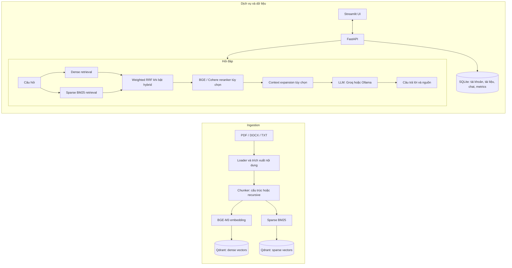

# Hệ thống hỏi đáp tài liệu tiếng việt VietRAG 🧠

Hệ thống hỏi đáp tiếng Việt theo kiến trúc Retrieval-Augmented Generation (RAG). Người dùng nạp tài liệu PDF hoặc DOCX, hệ thống trích xuất và chia tài liệu thành các đoạn, lập chỉ mục trong Qdrant, tìm ngữ cảnh liên quan rồi dùng mô hình ngôn ngữ để tạo câu trả lời có dẫn nguồn.

VietRAG gồm API FastAPI, giao diện Streamlit, pipeline ingest/retrieval/generation, lưu trữ dữ liệu trên Qdrant và SQLite, cùng bộ đánh giá trên 50 câu hỏi tiếng Việt tự xây dựng.

## ✨ Tính năng

- 📄 Đọc PDF, DOCX và TXT; hỗ trợ OCR cho PDF scan khi đã cài Tesseract và dữ liệu ngôn ngữ phù hợp.
- 🧱 Chia đoạn theo cấu trúc tài liệu khi loader cung cấp các block có cấu trúc; lưu metadata như tên file, trang và tiêu đề mục.
- 🧠 Tạo dense embedding bằng `BAAI/bge-m3` (1024 chiều) và lưu vector trong Qdrant.
- 🔎 Tìm kiếm dense; tùy chọn kết hợp sparse BM25 qua Qdrant bằng Weighted Reciprocal Rank Fusion (RRF).
- 🎯 Tùy chọn xếp hạng lại kết quả bằng `BAAI/bge-reranker-v2-m3` hoặc Cohere Rerank.
- 💬 Sinh câu trả lời bằng Groq hoặc Ollama; trả về các đoạn nguồn để giao diện hiển thị.
- 👤 Quản lý tài khoản, lịch sử hội thoại, tài liệu và telemetry qua FastAPI/SQLite.
- 🌐 Giao diện Streamlit kết nối FastAPI backend.

## 🏗️ Kiến trúc



### 🔄 Luồng xử lý

1. 📥 **Nạp tài liệu:** loader trích xuất nội dung; chunker tạo các đoạn có metadata. Với ingest qua giao diện/API, tài liệu được xử lý nền và gắn với chủ sở hữu.
2. 🗂️ **Lập chỉ mục:** BGE-M3 tạo dense embedding. Quy trình ingest qua API tạo collection có dense và sparse BM25 để hỗ trợ hybrid search.
3. 🔍 **Truy xuất:** pipeline chạy dense search hoặc kết hợp dense và BM25; khi hybrid bật, thứ hạng được hợp nhất bằng Weighted RRF.
4. ✨ **Rerank và tạo câu trả lời:** reranker có thể sắp xếp lại các ứng viên; các đoạn được chọn chuyển cho LLM. Câu trả lời trả về cùng nguồn và metadata thời gian.
5. 💾 **Lưu trữ:** Qdrant lưu vector và payload; SQLite lưu dữ liệu ứng dụng như tài khoản, registry tài liệu, lịch sử chat và telemetry.

### 🧩 Các thành phần chính

| Thư mục                                        | Trách nhiệm                                                              |
| ---------------------------------------------- | ------------------------------------------------------------------------ |
| `api/`                                         | FastAPI, xác thực, endpoint chat và quản lý tài liệu                     |
| `app/`                                         | Giao diện Streamlit, client gọi API và các thành phần UI                 |
| `configs/`                                     | Cấu hình pipeline và prompt cho hỏi đáp/đánh giá                         |
| `scripts/`                                     | Lệnh ingest, truy vấn, đánh giá và khởi động API                         |
| `src/ingestion/`                               | Loader, chunker, embedding, indexer và xử lý tài liệu                    |
| `src/retrieval/`                               | Dense/hybrid retrieval, reranker, mở rộng ngữ cảnh và pipeline truy xuất |
| `src/generation/`                              | Prompt builder và tích hợp Groq/Ollama                                   |
| `src/evaluation/`                              | Dataset, metric, LLM judge và bộ điều phối đánh giá                      |
| `src/storage/`, `src/chat/`, `src/monitoring/` | SQLite, lịch sử chat và telemetry                                        |
| `test/`                                        | Kiểm thử API, ingestion, retrieval, pipeline và storage                  |
| `data/eval/`                                   | Bộ câu hỏi và các snapshot kết quả benchmark                             |

## 📊 Kết quả đánh giá

Bộ test `data/eval/testset.jsonl` gồm **50 câu hỏi**: 30 câu hỏi trực tiếp, 10 câu hỏi suy luận có thể trả lời và 10 câu hỏi không có đáp án trong tài liệu. Các summary ghi nhận **40 câu answerable** và **10 câu unanswerable**. Bảng dưới đây tổng hợp ba snapshot hiện có trong `data/eval/`.

### 🔎 Retrieval

| Cấu hình                        |  Hit@1 |  Hit@3 |   Hit@5 |    MRR | Context Recall |  Độ trễ TB |
| ------------------------------- | -----: | -----: | ------: | -----: | -------------: | ---------: |
| 🔹 Dense vector, không reranker | 67,50% | 92,50% |  95,00% | 79,38% |         90,63% | 4,333 giây |
| 🎯 Dense vector + reranker      | 80,00% | 92,50% |  97,50% | 87,50% |         96,88% | 18,27 giây |
| 🔀 Hybrid search + reranker     | 80,00% | 95,00% | 100,00% | 88,75% |         99,38% | 19,60 giây |

### 💬 Generation và từ chối câu hỏi ngoài phạm vi

| Cấu hình                        | Semantic Similarity | Answer Relevancy (LLM Judge) | Token F1 | Từ chối đúng / 10 câu ngoài phạm vi |
| ------------------------------- | ------------------: | ---------------------------: | -------: | ----------------------------------: |
| 🔹 Dense vector, không reranker |              72,50% |                       83,40% |   41,44% |                          9/10 (90%) |
| 🎯 Dense vector + reranker      |              74,55% |                       93,30% |   43,18% |                          9/10 (90%) |
| 🔀 Hybrid search + reranker     |              73,46% |                       95,80% |   40,67% |                        10/10 (100%) |

**Nhận xét:** trong các snapshot này, reranker cải thiện Hit@1, MRR và Context Recall so với dense-only. Hybrid kết hợp reranker có Hit@3 95%, Hit@5 100% và Context Recall 99,38%; tỷ lệ từ chối đúng trên nhóm câu hỏi ngoài phạm vi là 100%. Token F1 không tăng tương ứng ở cấu hình hybrid, cho thấy chất lượng retrieval và độ trùng khớp câu chữ của câu trả lời là các khía cạnh khác nhau.

Đây là snapshot benchmark trong quá trình phát triển, không phải cam kết hiệu năng. Artifact kết quả có thể được tạo lại bằng `scripts/run_eval.py`; chỉ commit/công bố số liệu khi JSON output tương ứng cũng được lưu trong `data/eval/`. Thời gian còn phụ thuộc phần cứng, tải dịch vụ và API. Khi cần so sánh có kiểm soát, hãy giữ nguyên collection, prompt, LLM, top-k/top-n và phiên bản dữ liệu, chỉ thay đổi tùy chọn retrieval.

### 🧪 Chạy lại benchmark

`scripts/run_eval.py` dùng cấu hình trong `configs/config.yaml`; cờ `--no-rerank` và `--no-hybrid` chỉ tắt tính năng. Để chạy từng cấu hình, chỉnh hai khóa `retrieval.reranker.enabled` và `retrieval.hybrid_search.enabled` trong YAML, sau đó chạy:

```powershell
# Đánh giá toàn bộ 50 câu; mặc định có gọi LLM Judge
python scripts/run_eval.py `
  --output data/eval/my_results.json `
  --output-csv data/eval/my_details.csv

# Chạy thử nhanh, bỏ qua LLM Judge
python scripts/run_eval.py --limit 5 --no-judge
```

Các chế độ tương ứng: `false/false` = dense-only; `true/false` = dense + reranker; `true/true` = hybrid + reranker. Thứ tự là `reranker.enabled / hybrid_search.enabled`. Để dùng hybrid, collection phải có sparse vector BM25; ingest qua giao diện/API tạo index dạng này.

## 🚀 Chạy demo

### 🖥️ Demo RAG

Yêu cầu Python, Docker Desktop, khóa Groq (hoặc cấu hình Ollama), và đủ bộ nhớ để tải/chạy embedding cùng reranker. Trên máy không có GPU NVIDIA, đổi `embedding.device` và `retrieval.reranker.bge.device` trong `configs/config.yaml` thành `cpu`.

1. Tạo môi trường và cài dependencies:

   ```powershell
   python -m venv .venv
   .\.venv\Scripts\Activate.ps1
   python -m pip install -r requirements.txt
   Copy-Item .env.example .env
   ```

2. Thêm khóa LLM vào `.env` (không đưa file này lên Git):

   ```dotenv
   GROQ_API_KEY=your_groq_api_key
   QDRANT_HOST=localhost
   QDRANT_PORT=6333
   ```

   Có thể đặt `EVAL_GROQ_API_KEY` riêng cho LLM Judge. Nếu dùng Ollama, cấu hình `llm.default_provider`, model và URL trong `configs/config.yaml` rồi khởi động Ollama.

3. Khởi động Qdrant:

   ```powershell
   docker compose up -d
   ```

   Dashboard: `http://localhost:6333/dashboard`.

4. Tạo collection rỗng tương thích với ingest qua UI/API. Lệnh này tạo dense vector, sparse BM25 và các payload index cần thiết; lệnh sẽ từ chối ghi đè collection đã tồn tại.

   ```powershell
   # Giá trị --collection phải khớp vector_store.collection_name trong configs/config.yaml
   python scripts/create_demo_collection.py --collection vietnamese_docs_demo_20261026
   ```

   Nếu bạn đã có collection đúng schema thì bỏ qua bước này. Không dùng `--recreate` hoặc xóa collection hiện có nếu chưa chủ động sao lưu dữ liệu.

5. Mở terminal thứ nhất, kích hoạt `.venv` nếu cần, rồi chạy API:

   ```powershell
   python scripts/run_api.py
   ```

   Kiểm tra API tại `http://localhost:8000/health`; tài liệu endpoint ở `http://localhost:8000/docs`.

6. Mở terminal thứ hai, kích hoạt `.venv` và chạy Streamlit kết nối backend:

   ```powershell
   $env:RAG_API_URL = "http://localhost:8000"
   streamlit run app/app.py
   ```

7. Truy cập `http://localhost:8501`, đăng ký tài khoản, tải tài liệu PDF/DOCX trong mục kho tri thức, chờ trạng thái xử lý hoàn tất rồi đặt câu hỏi trong màn hình chat.

### Giới hạn upload và vòng đời document

- UI hiện nhận **PDF/DOCX**, tối đa **10 MB mỗi file**. Pipeline/CLI có thể xử lý TXT nếu extension đó được bật trong `data.supported_extensions`.
- Upload tạo job nền. Khi trạng thái là `queued` hoặc `processing`, tài liệu chưa thể được dùng để hỏi đáp.
- Xóa document tạo job `deleting`; UI không chờ Qdrant xóa từng vector. Worker xóa theo `owner_user_id + doc_id`, sau đó mới gỡ registry record.
- Danh sách documents và chunk viewer đều được phân trang để không tải toàn bộ metadata/chunk text vào giao diện.

Để bật reranker và hybrid search cho phiên chạy thật, đặt các khóa sau trong `configs/config.yaml`:

```yaml
retrieval:
  hybrid_search:
    enabled: true
  reranker:
    enabled: true
```

Để chỉ dùng dense vector + reranker, bật `reranker.enabled` và để `hybrid_search.enabled: false`. Cấu hình collection, embedding device và các tham số retrieval khác cũng nằm trong file YAML này.

## ⚙️ Cấu hình và lệnh CLI

Cấu hình chính ở `configs/config.yaml`; prompt hỏi đáp và đánh giá nằm trong `configs/prompts/`. Một số biến môi trường thường dùng:

| Biến                         | Mục đích                                                      |
| ---------------------------- | ------------------------------------------------------------- |
| `GROQ_API_KEY`               | Khóa sinh câu trả lời khi dùng Groq                           |
| `EVAL_GROQ_API_KEY`          | Khóa riêng cho LLM Judge; nếu bỏ trống sẽ dùng `GROQ_API_KEY` |
| `QDRANT_HOST`, `QDRANT_PORT` | Địa chỉ Qdrant local hoặc remote                              |
| `QDRANT_API_KEY`             | Khóa truy cập Qdrant Cloud nếu cần                            |
| `OLLAMA_BASE_URL`            | URL Ollama nếu chạy mô hình cục bộ                            |
| `RAG_API_URL`                | Địa chỉ FastAPI backend cho Streamlit                         |
| `RAG_ENV`                    | Đặt `production` khi triển khai thật                          |
| `RAG_AUTH_SECRET`            | Chuỗi ngẫu nhiên tối thiểu 32 ký tự để ký access token        |

Khi `RAG_ENV=production`, `RAG_AUTH_SECRET` là bắt buộc. Ví dụ:

```dotenv
RAG_ENV=production
RAG_AUTH_SECRET=thay-bang-chuoi-ngau-nhien-it-nhat-32-ky-tu
```

Không commit `.env`, `rag.sqlite3`, file upload gốc hoặc API key. Khi deploy, cần backup tối thiểu cả Qdrant volume, `data/processed/rag.sqlite3` và thư mục `data/raw/uploads/` nếu muốn khôi phục đầy đủ tài khoản, lịch sử và tài liệu nguồn.

### Multi-user và dữ liệu lưu trữ

- Ứng dụng dùng một Qdrant collection chung. Payload luôn có `owner_user_id`; truy vấn, xem chunks và xóa document được lọc theo owner ở backend.
- SQLite mặc định tại `data/processed/rag.sqlite3` lưu `users`, `documents`, `chat_sessions`, `chat_messages`, `feedback` và `query_events`.
- Chat history chỉ lưu câu hỏi/câu trả lời và metadata nguồn rút gọn (file, section path, trang, score); không nhân bản text chunk vào SQLite. Session không hoạt động quá 90 ngày sẽ được dọn tự động khi hệ thống đọc/ghi history.
- Xóa session sẽ cascade xóa messages và feedback liên quan. Khi triển khai xóa tài khoản, cần xử lý/chuyển quyền documents trước vì documents có chính sách bảo vệ ownership.

Các lệnh tiện ích:

```powershell
# Tạo chunks và index dense vào collection đang cấu hình
python scripts/run_ingest.py --source data/raw --index

# Hỏi đáp từ terminal
python scripts/run_query.py --query "Câu hỏi của bạn"

# Chỉ xem các đoạn được truy xuất, không gọi LLM
python scripts/run_query.py --query "Câu hỏi của bạn" --retrieve-only
```

`--versioned-index` tạo collection mới có dense và BM25, không thay thế collection hiện tại. Các lệnh ingest CLI không gắn tài liệu với tài khoản người dùng; với demo qua API/UI, nên tải tài liệu qua giao diện để hệ thống quản lý owner và registry đúng luồng.

## ✅ Kiểm thử

```powershell
# Chạy toàn bộ unit/integration tests cục bộ
python -m unittest discover -s test -v
```

## 🛠️ Khắc phục lỗi thường gặp

| Hiện tượng                          | Kiểm tra/cách xử lý                                                                                            |
| ----------------------------------- | -------------------------------------------------------------------------------------------------------------- |
| Streamlit báo không kết nối backend | Chạy `python scripts/run_api.py`, rồi mở `http://localhost:8000/health`; kiểm tra `RAG_API_URL`.               |
| API không kết nối Qdrant            | Chạy `docker compose ps`; kiểm tra dashboard `http://localhost:6333/dashboard` và `QDRANT_HOST`/`QDRANT_PORT`. |
| Upload báo lỗi schema collection    | Kiểm tra `vector_store.collection_name`; tạo collection tương thích bằng `scripts/create_demo_collection.py`.  |
| Không có CUDA hoặc lỗi VRAM         | Đổi `embedding.device` và `retrieval.reranker.bge.device` sang `cpu`; giảm `embedding.batch_size`.             |
| PDF scan không đọc được             | Cài Tesseract, language data `vie`/`eng`, sau đó kiểm tra `data.pdf_ocr` trong config.                         |
| Không có câu trả lời từ Groq        | Kiểm tra `GROQ_API_KEY`, model Groq cấu hình và quota; hoặc chuyển sang Ollama trong `configs/config.yaml`.    |
